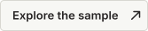

<h1 align="center">GlassBench</h1>

<p align="center"><strong>Depth cameras return a confident wrong value on 8.6% to 65.6% of transparent-object pixels.</strong><br>A three-bucket benchmark of silent depth failures on glass, measured on 4,510 real RGB-D images.</p>

<p align="center">
  <a href="https://github.com/limit-case/glassbench/issues/new?template=custom-batch-request.yml"></a>
  &nbsp;
  <a href="examples/"></a>
</p>

<p align="center">
  <a href="DATASHEET.md">Datasheet</a> ·
  <a href="docs/schema.md">Schema</a> ·
  <a href="docs/measurement.md">Measurement</a>
</p>

---

## At a glance

| Real images | Evaluation sets | Confidently wrong on glass | Wrong readings that are too far |
|:---:|:---:|:---:|:---:|
| **4,510** | **5** | **8.6% to 65.6%** | **at least 99.8%** |

Raw sensor depth on the transparent-object mask, GT-valid pixels, 5% tolerance, pooled over pixels. The five sets are ClearGrasp real images (RealSense D415, D435 test, D435 val) and TransCG real images (RealSense D435, Intel L515).

## See it


*Figure 1. One TransCG L515 view. Inside the transparent-object mask the sensor returns a depth almost everywhere, and most of it is wrong. Green is correct, red is confidently wrong. Derived from a TransCG frame; it follows the TransCG terms (CC BY-NC-SA 4.0).*

Load the open sample and print its three-bucket table:

```bash
pip install -r tools/requirements.txt
python examples/load_sample.py
```

## Why silent failures matter

A depth camera can fail loudly or quietly. On ClearGrasp D415 images, 62.5% of glass pixels come back empty, which a planner can see and route around. On TransCG L515 images only 4.4% are empty, and 65.6% come back as a depth that is wrong by more than 5%. Nothing in the frame marks them.

The wrong readings are not scattered noise. In every set at least 99.8% of them read farther than the ground truth, by a median of 3.5 to 6.2 cm: the sensor measures the surface behind the glass.

Existing models do not fix this in general. DFNet lowers the wrong share on TransCG D435 test scenes from 13.2% to 6.2%, and raises it on ClearGrasp D415 from 13.8% to 39.0%. An RGB-only mask network covers 91.5% to 99.3% of the wrong pixels on ClearGrasp, but its predicted masks are 1.5 to 2.6 times the true area.

The open sample comes from a larger generator that is calibrated per camera against held-out real captures, and can be re-calibrated for a new camera and object set.

## Comparable datasets

| Dataset | Size | Real / synthetic | Raw sensor depth | Failure labels | Sensor-calibrated | Licence |
|---|--:|---|---|---|---|---|
| [ClearGrasp](https://github.com/Shreeyak/cleargrasp) | over 50,000 synthetic, 286 real | both | real images only | no | no | Apache-2.0 |
| [TransCG](https://graspnet.net/transcg) | 57,715 | real | yes | no | not applicable | CC BY-NC-SA 4.0 |
| [DREDS / STD](https://github.com/PKU-EPIC/DREDS) | about 130,000 simulated, 38,000 real | both | STD (real) | no | simulates a D415-like sensor | CC BY-NC 4.0 |
| **GlassBench** | 4,510 real images evaluated, not redistributed; 9 synthetic scenes open | real (evaluated), synthetic (open) | simulated | yes, three buckets | per camera, held out (43.3 to 7.4 points on L515) | Apache-2.0 code, CC BY 4.0 sample |

*Failure labels* means per-pixel missing / correct / wrong labels shipped with the data. The other datasets ship masks and ground-truth depth, and such labels can be derived from them; the benchmark derives them. Sizes and licences are as stated in each dataset's own repository or paper. GlassBench evaluates ClearGrasp and TransCG; it does not replace them.

## Documentation

| File | What it answers |
|---|---|
| [`DATASHEET.md`](DATASHEET.md) | Who made this, how, from what and what it should not be used for |
| [`docs/schema.md`](docs/schema.md) | Every file and field in `data/` and in the sample |
| [`docs/measurement.md`](docs/measurement.md) | How each published number is computed |
| [`docs/provenance.md`](docs/provenance.md) | Source datasets, unit verification, rendering and the calibration protocol |
| [`docs/access.md`](docs/access.md) | What is free, what is on request, and the licences |
| [`docs/results.md`](docs/results.md) | Every result table, with the figures |
| [`examples/README.md`](examples/README.md) | How to load the sample |
| [`tools/README.md`](tools/README.md) | How to reproduce each table |

Machine-readable equivalents live in [`data/`](data/): the result CSVs, `benchmark-stats.json`, `fields.json`, the simulator configs and the JSON Schemas in `data/schema/`.

## Licences

Code: Apache-2.0. Synthetic sample, documentation and result files: CC BY 4.0. ClearGrasp: Apache-2.0. TransCG: CC BY-NC-SA 4.0, research use only; it is not redistributed here, and any figure or result derived from TransCG follows its terms. See [`docs/access.md`](docs/access.md).

## Citation

```bibtex
@misc{glassbench,
  title     = {GlassBench: Silent Depth Failures on Transparent Objects},
  author    = {Limit Case},
  year      = {2026},
  version   = {0.1.0},
  publisher = {Limit Case},
  url       = {https://github.com/limit-case/glassbench},
}
```

## Acknowledgements

This benchmark measures other people's captures. We thank the authors of [ClearGrasp](https://arxiv.org/abs/1910.02550) and [TransCG](https://arxiv.org/abs/2202.08471) for releasing real transparent-object data with ground truth, the authors of TransCG's DFNet for the depth-completion model we evaluate, and the authors of [Depth Anything V2](https://arxiv.org/abs/2406.09414) for the monocular model we evaluate.

---

<p align="center">
  <a href="https://github.com/limit-case"><strong>Limit Case</strong></a><br>
  <a href="https://github.com/limit-case/glassbench">GitHub</a>
</p>
