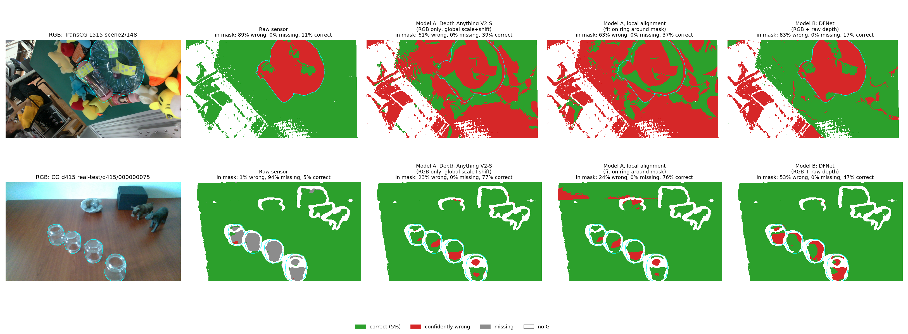
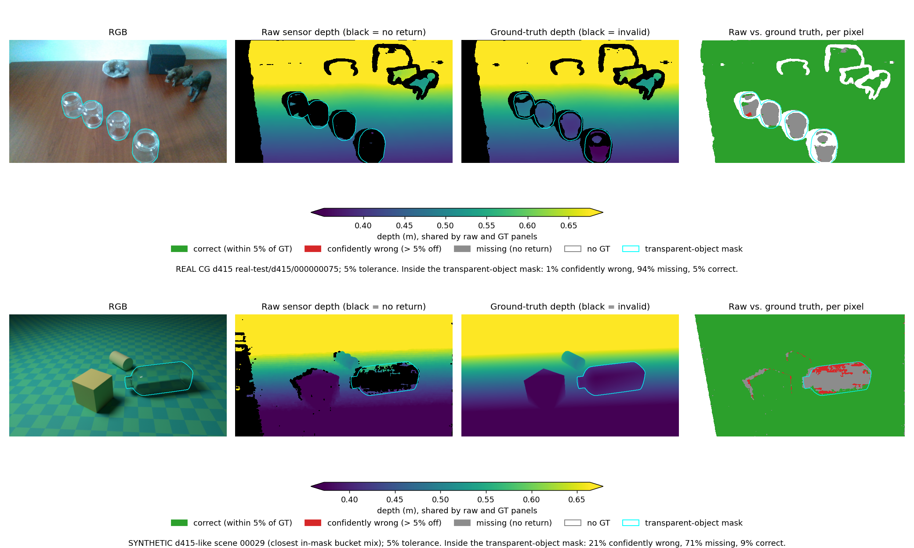
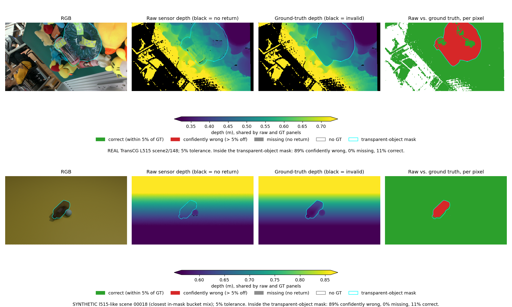
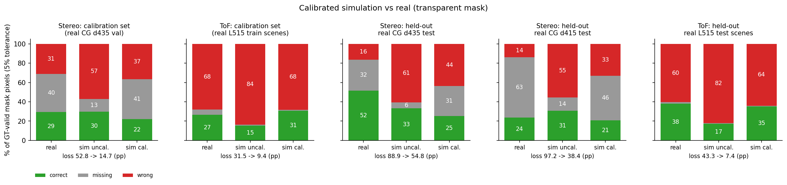
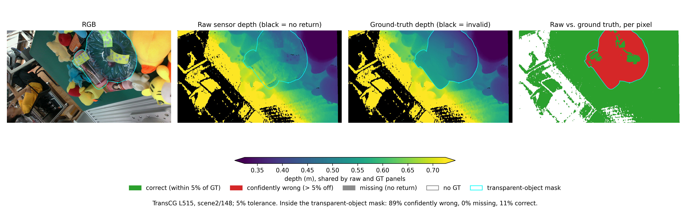
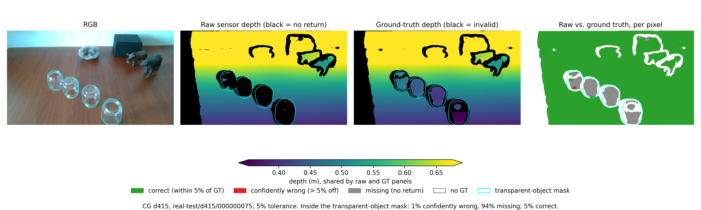

# GlassBench results

All numbers below are produced by `tools/evaluation/three_bucket.py`, `tools/checks/check_transcg_pose.py` and `tools/checks/check_scale.py`; this file is generated by `tools/readme/make_results.py` from the CSVs in the repo.

## Headline

On transparent objects, the raw depth from all four sensors is often confidently wrong, not just missing: at a 5% tolerance, 8.6% (TransCG D435) to 65.6% (TransCG L515) of GT-valid pixels inside the transparent mask are wrong, and among the pixels where a sensor returns a depth, 11.6% to 68.6% are wrong. At least 99.8% of the wrong pixels read farther than the GT (consistent with the sensor seeing through the glass), by a median of 3.5 to 6.2 cm.

The ClearGrasp stereo sensors (d415, d435) mostly drop out on glass: 62.5% (d415) and 32.2% (d435 real-test) of mask pixels are missing, versus 4.4% for the L515. With the per-image bias correction applied, ClearGrasp mask results are essentially unchanged (wrong: d415 13.8%, d435 test 16.3%, d435 val 31.1%), so the glass failure is not explained by a smooth depth bias between captures.

## Data

| Dataset | Split / subset | Camera | Samples | Notes |
|---|---|---|---|---|
| ClearGrasp (real) | real-test | RealSense D415 | 90 | primary |
| ClearGrasp (real) | real-test | RealSense D435 | 23 | primary D435 result |
| ClearGrasp (real) | real-val | RealSense D435 | 173 | reported separately |
| TransCG | scenes 1-10 (local copy) | RealSense D435 | 2175 | views with depth1-gt.png |
| TransCG | scenes 1-10 (local copy) | Intel L515 | 2049 | views with depth2-gt.png |

The local TransCG copy contains only scenes 1-10 (10 scenes). `metadata.json` describes 130 scenes (28,967 D435 and 28,748 L515 samples), so these results use a subset. All local scenes are used regardless of the dataset's train/test split.

Licences: ClearGrasp is Apache-2.0; TransCG is CC BY-NC-SA. Research use only.

## Units

See `docs/provenance.md`. ClearGrasp depth is float16 meters. TransCG depth PNGs are uint16: D435 is divided by 1000 (mm), L515 by 4000 (0.25 mm). `metadata.json` has no scale, so both were verified against object pose z (`tools/checks/check_transcg_pose.py`; poses are in meters, projected with the camera intrinsics, GT depth taken as the median in a 15x15 window; ratio is GT depth / pose z):

```
20 views, 61 poses, D435 pose z: median=0.459 min=0.379 max=0.536
D435 gt: n=61 (skipped 0) ratio median=0.943 p10=0.910 p90=1.036 min=0.869 max=1.059
L515 gt (T): n=59 (skipped 2) ratio median=0.949 p10=0.921 p90=1.058 min=0.899 max=1.097
L515 raw (T): n=58 (skipped 3) ratio median=1.057 p10=0.976 p90=1.099 min=0.936 max=1.140
L515 gt (T^-1): n=55 (skipped 6) ratio median=1.684 p10=1.297 p90=2.576 min=1.217 max=7.929
L515 raw (T^-1): n=55 (skipped 6) ratio median=1.694 p10=1.360 p90=2.576 min=1.217 max=7.929
```

A ratio slightly below 1 is expected because the GT depth is the object surface and the pose is the object center. With the old L515 divisor of 1000 the ratio was 3.79; /4000 gives the value above. TransCG's own code (`utils/data_preparation.py`, `process_depth`) also divides D435 depth by 1000 and L515 depth by 4000, independently confirming the scales. `T_camera2_camera1.npy` maps D435 to L515 as written (forward); its inverse gives scattered ratios (1.2-7.9).

## Method

- Only GT-valid pixels (GT finite and > 0) are counted.
- Each pixel is one of three buckets: **missing** (raw == 0), **correct** (raw > 0 and |raw - GT| <= tol), **confidently wrong** (raw > 0 and |raw - GT| > tol).
- Tolerances: 1 cm absolute, and 5% of GT (relative). Both are in the CSVs; tables here use 5% unless noted.
- Region: the transparent mask. ClearGrasp also has a non-mask control region (the original complement of the mask). TransCG GT equals raw outside the mask, so it has no control region.
- 'Too far' share = wrong pixels with raw > GT, divided by all wrong pixels. 'Wrong among returned' = wrong / (correct + wrong).
- Values are pooled over all pixels of a camera; the bracket is the per-image median of the same percentage.
- Mask erosion check: the mask is eroded by N = 3 and 5 pixels (elliptical kernel) to test whether boundary pixels drive the result.
- Bias correction (ClearGrasp only): per image, fit raw = a*GT + b*x + c*y + d by least squares on GT-valid, non-mask, raw > 0 pixels (one refit after dropping the top 5% of residuals), then invert it on the returned raw depth.

## Main result (transparent mask, 5% tolerance)

| Camera | Images | Correct % | Missing % | Wrong % | Wrong too far % | Wrong among returned % |
|---|---|---|---|---|---|---|
| CG d415 | 90 | 23.6 [26.1] | 62.5 [60.5] | 13.8 [11.9] | 100.0 | 36.9 |
| CG d435 test (primary) | 23 | 51.6 [60.0] | 32.2 [22.6] | 16.2 [12.7] | 100.0 | 23.9 |
| CG d435 val | 173 | 29.3 [27.1] | 39.7 [45.5] | 30.9 [23.0] | 99.8 | 51.3 |
| TransCG D435 | 2175 | 65.3 [66.7] | 26.2 [25.1] | 8.6 [9.0] | 100.0 | 11.6 |
| TransCG L515 | 2049 | 30.0 [32.4] | 4.4 [1.2] | 65.6 [64.9] | 100.0 | 68.6 |

Pooled % of GT-valid mask pixels, per-image median in brackets. These are uncorrected; bias correction changes the ClearGrasp rows by the amounts shown in the Robustness section.

Same table at the 1 cm tolerance:

| Camera | Images | Correct % | Missing % | Wrong % | Wrong too far % | Wrong among returned % |
|---|---|---|---|---|---|---|
| CG d415 | 90 | 14.8 [14.3] | 62.5 [60.5] | 22.6 [22.1] | 99.2 | 60.4 |
| CG d435 test | 23 | 22.9 [25.4] | 32.2 [22.6] | 44.9 [46.1] | 99.5 | 66.2 |
| CG d435 val | 173 | 14.4 [12.1] | 39.7 [45.5] | 45.9 [42.0] | 99.2 | 76.2 |
| TransCG D435 | 2175 | 56.9 [58.9] | 26.2 [25.1] | 17.0 [17.7] | 100.0 | 23.0 |
| TransCG L515 | 2049 | 4.3 [3.6] | 4.4 [1.2] | 91.3 [92.0] | 100.0 | 95.5 |

## Error size of confidently wrong pixels

raw - GT in cm, over confidently wrong mask pixels, pooled (0.05 cm histogram resolution).

| Camera | median, 5% | p90, 5% | median, 1 cm | p90, 1 cm |
|---|---|---|---|---|
| CG d415 | 5.2 | 8.7 | 3.6 | 7.8 |
| CG d435 test | 3.9 | 5.6 | 2.4 | 4.3 |
| CG d435 val | 6.2 | 10.8 | 4.3 | 9.6 |
| TransCG D435 | 3.5 | 5.9 | 2.2 | 4.9 |
| TransCG L515 | 5.8 | 10.0 | 4.2 | 9.4 |

## Robustness

### Mask erosion (5% tolerance, transparent mask)

| Camera | Erosion px | Correct % | Missing % | Wrong % | Wrong too far % |
|---|---|---|---|---|---|
| CG d415 | 0 | 23.6 [26.1] | 62.5 [60.5] | 13.8 [11.9] | 100.0 |
| CG d415 | 3 | 21.3 [23.5] | 64.3 [61.7] | 14.4 [12.3] | 100.0 |
| CG d415 | 5 | 19.5 [21.6] | 65.5 [62.9] | 15.0 [13.0] | 100.0 |
| CG d435 test | 0 | 51.6 [60.0] | 32.2 [22.6] | 16.2 [12.7] | 100.0 |
| CG d435 test | 3 | 48.4 [56.7] | 34.0 [23.5] | 17.6 [13.4] | 100.0 |
| CG d435 test | 5 | 46.0 [54.0] | 35.3 [23.9] | 18.7 [14.1] | 100.0 |
| CG d435 val | 0 | 29.3 [27.1] | 39.7 [45.5] | 30.9 [23.0] | 99.8 |
| CG d435 val | 3 | 27.1 [24.1] | 40.9 [47.1] | 32.1 [23.7] | 99.9 |
| CG d435 val | 5 | 25.5 [22.7] | 41.6 [47.1] | 32.9 [24.6] | 99.9 |
| TransCG D435 | 0 | 65.3 [66.7] | 26.2 [25.1] | 8.6 [9.0] | 100.0 |
| TransCG D435 | 3 | 65.4 [67.2] | 26.1 [25.1] | 8.5 [9.0] | 100.0 |
| TransCG D435 | 5 | 65.4 [67.3] | 26.1 [25.0] | 8.5 [9.0] | 100.0 |
| TransCG L515 | 0 | 30.0 [32.4] | 4.4 [1.2] | 65.6 [64.9] | 100.0 |
| TransCG L515 | 3 | 29.9 [32.3] | 4.4 [1.1] | 65.7 [65.1] | 100.0 |
| TransCG L515 | 5 | 29.8 [32.2] | 4.4 [1.1] | 65.8 [65.3] | 100.0 |

### CG d435: real-test vs real-val

Shown in the main table. The two splits differ strongly (wrong at 5%: 16.2% on test vs 30.9% on val; non-mask wrong at 1 cm: 1.4% vs 6.8%). Pooling them would have mixed two different capture conditions, so real-test is the primary D435 result.

### Per-image bias correction (ClearGrasp, transparent mask)

| Camera | Tol | Correct % raw | Correct % corrected | Wrong % raw | Wrong % corrected | Missing % (both) | Wrong error cm med/p90 raw | corrected |
|---|---|---|---|---|---|---|---|---|
| CG d415 | 5% | 23.6 | 23.6 | 13.8 | 13.8 | 62.5 | 5.2 / 8.7 | 5.2 / 8.7 |
| CG d415 | 1 cm | 14.8 | 14.9 | 22.6 | 22.5 | 62.5 | 3.6 / 7.8 | 3.6 / 7.8 |
| CG d435 test | 5% | 51.6 | 51.6 | 16.2 | 16.3 | 32.2 | 3.9 / 5.6 | 3.9 / 5.6 |
| CG d435 test | 1 cm | 22.9 | 22.9 | 44.9 | 44.9 | 32.2 | 2.4 / 4.3 | 2.4 / 4.3 |
| CG d435 val | 5% | 29.3 | 29.2 | 30.9 | 31.1 | 39.7 | 6.2 / 10.8 | 6.1 / 10.8 |
| CG d435 val | 1 cm | 14.4 | 14.3 | 45.9 | 45.9 | 39.7 | 4.3 / 9.6 | 4.3 / 9.6 |

Fitted parameter distribution (median [min-max] over images). `tilt` is the plane gradient across the image in cm, `d` the offset at the image center in cm, and `bias RMS` is the RMS of the fitted model minus GT over the fit pixels (cm). `a` and `d` are collinear when an image's GT depth range is narrow, so individually they can be large while the net bias stays small; bias RMS is the reliable size measure.

| Camera | Images fit | a | tilt cm | d cm | bias RMS cm |
|---|---|---|---|---|---|
| CG d415 | 90 | 1.0000 [0.9981 - 1.0029] | 0.024 [0.002 - 0.164] | 0.002 [-0.167 - 0.122] | 0.007 [0.002 - 0.044] |
| CG d435 test | 23 | 0.9995 [0.9922 - 1.0017] | 0.047 [0.006 - 0.695] | 0.037 [-0.112 - 0.244] | 0.016 [0.004 - 0.404] |
| CG d435 val | 173 | 0.9992 [0.8379 - 1.1059] | 0.088 [0.002 - 11.449] | 0.055 [-8.590 - 12.742] | 0.022 [0.004 - 1.237] |

## Control: ClearGrasp non-mask pixels

| Camera | Tol | Correct % raw | Correct % corrected | Missing % | Wrong % raw | Wrong % corrected | Wrong % per-image median / p90 (raw) |
|---|---|---|---|---|---|---|---|
| CG d415 | 1 cm | 98.9 | 98.9 | 1.0 | 0.0 | 0.0 | 0.0 / 0.1 |
| CG d415 | 5% | 98.9 | 98.9 | 1.0 | 0.0 | 0.0 | 0.0 / 0.0 |
| CG d435 test | 1 cm | 92.5 | 92.6 | 6.1 | 1.4 | 1.3 | 0.3 / 1.4 |
| CG d435 test | 5% | 93.9 | 93.9 | 6.1 | 0.0 | 0.0 | 0.0 / 0.0 |
| CG d435 val | 1 cm | 87.1 | 87.6 | 6.1 | 6.8 | 6.3 | 0.7 / 24.1 |
| CG d435 val | 5% | 93.8 | 93.8 | 6.1 | 0.1 | 0.1 | 0.0 / 0.3 |

The correction is fit on these same pixels, so the corrected control numbers are in-sample; the mask region is out-of-sample.

## Do existing models fix it?

Two existing models were run on the same images and scored with the same three buckets, on the transparent mask, GT-valid pixels. Model outputs are dense, so 'missing' is about 0 for them; 'wrong among returned' is then just 'wrong'. All model weights are stored outside the repo in `~/glassbench_models/`.

| Model | Input | Source / licence |
|---|---|---|
| A: Depth Anything V2 Small (relative) | RGB only | `depth-anything/Depth-Anything-V2-Small-hf`; Apache-2.0 (HF model card) |
| A: Depth Anything V2 Metric-Indoor-Small | RGB only | `depth-anything/Depth-Anything-V2-Metric-Indoor-Small-hf`; the HF card has no licence field, the upstream README states the Small models are Apache-2.0 (not stated per metric checkpoint) |
| B: TransCG DFNet | RGB + raw depth | official `galaxies99/transcg` code and checkpoint (Google Drive link in its README); CC BY-NC-SA 4.0; checkpoint epoch 12 |
| Mask segmentation (flagging) | RGB only | ClearGrasp `mask_segmentation` checkpoint (DRN DeepLabV3), ClearGrasp repo Apache-2.0 |

**Protocol.**
- *Sample.* All ClearGrasp real images (d415, d435 real-test, d435 real-val separately) and a fixed random subset of 300 views per TransCG camera (seed 0). The raw-sensor rows here are computed on the same subset, so TransCG raw numbers differ slightly from the full-data tables above.
- *Model A alignment.* Model A never sees raw depth. Its output is relative inverse depth, so per image a scale and shift is fit by least squares in inverse-depth space on GT-valid pixels *outside* the transparent mask (global alignment, the specified protocol), then inverted to depth; evaluation inside the mask is out of sample. For TransCG, GT equals the raw sensor depth outside the mask, so there the alignment uses raw sensor depth. The metric-indoor model is reported as is (zero-shot meters) and also with a scale+shift fit in depth space. Because a global fit is dominated by far background (see the alignment table), a *local* variant fits on GT-valid pixels in a 40 px ring around the mask instead; it is a sensitivity check, not the specified protocol.
- *Model B.* DFNet is run the way the official `inference.py` does: RGB and depth resized (nearest) to 320x240, depth clipped to 0.3-1.0 m (outside set to missing), values outside mean +/- 3 std dropped, holes filled by nearest-neighbour interpolation, depth normalized per image; the output is resized back to the GT resolution (nearest). Depth is in meters (D435 /1000, L515 /4000, matching DFNet's own `process_depth`).
- *DFNet and TransCG scenes.* `metadata.json` and each scene's `metadata.json` put scenes 5, 7, 8 in the **test** split and scenes 1, 2, 3, 4, 6, 9, 10 in the **train** split; the repo's default config trains on the train split. Only scenes 5, 7, 8 are treated as out-of-sample for DFNet and used for the TransCG DFNet headline; the other scenes are reported separately as in-sample. This rests on the repo's documented split; the released checkpoint's exact training set could not be independently verified. ClearGrasp real images are not part of DFNet's training data (cross-dataset).

### Results, transparent mask, 5% tolerance

| Camera | Model | Images | Correct % | Missing % | Wrong % | Wrong among returned % | Wrong too far % | Error cm (out - GT) median / p90 |
|---|---|---|---|---|---|---|---|---|
| CG d415 | raw sensor | 90 | 23.6 | 62.5 | 13.8 | 36.9 | 100.0 | 5.2 / 8.7 |
| CG d415 | A: DA-V2-S relative, global scale+shift | 90 | 51.2 | 0.0 | 48.8 | 48.8 | 98.8 | 4.3 / 7.5 |
| CG d415 | A: DA-V2-S relative, local (ring) scale+shift | 90 | 51.5 | 0.0 | 48.5 | 48.5 | 98.6 | 4.3 / 7.3 |
| CG d415 | A: DA-V2-S metric-indoor, as is | 90 | 0.0 | 0.0 | 100.0 | 100.0 | 100.0 | 58.0 / 109.8 |
| CG d415 | A: metric-indoor, global scale+shift | 90 | 50.4 | 0.0 | 49.6 | 49.6 | 91.8 | 4.3 / 7.6 |
| CG d415 | A: metric-indoor, local (ring) scale+shift | 90 | 56.7 | 0.0 | 43.3 | 43.3 | 88.9 | 4.1 / 7.3 |
| CG d415 | B: TransCG DFNet (RGB + raw depth) | 90 | 61.0 | 0.0 | 39.0 | 39.0 | 72.4 | 3.7 / 8.4 |
| CG d435 test | raw sensor | 23 | 51.6 | 32.2 | 16.2 | 23.9 | 100.0 | 3.9 / 5.6 |
| CG d435 test | A: DA-V2-S relative, global scale+shift | 23 | 72.9 | 0.0 | 27.1 | 27.1 | 81.0 | 3.9 / 6.4 |
| CG d435 test | A: DA-V2-S relative, local (ring) scale+shift | 23 | 70.0 | 0.0 | 30.0 | 30.0 | 99.5 | 4.0 / 6.0 |
| CG d435 test | A: DA-V2-S metric-indoor, as is | 23 | 0.0 | 0.0 | 100.0 | 100.0 | 100.0 | 51.0 / 129.8 |
| CG d435 test | A: metric-indoor, global scale+shift | 23 | 61.5 | 0.0 | 38.5 | 38.5 | 24.1 | -3.8 / 5.4 |
| CG d435 test | A: metric-indoor, local (ring) scale+shift | 23 | 77.2 | 0.0 | 22.8 | 22.8 | 68.5 | 3.3 / 5.6 |
| CG d435 test | B: TransCG DFNet (RGB + raw depth) | 23 | 68.3 | 0.0 | 31.7 | 31.7 | 23.5 | -4.2 / 3.6 |
| CG d435 val | raw sensor | 173 | 29.3 | 39.7 | 30.9 | 51.3 | 99.8 | 6.2 / 10.8 |
| CG d435 val | A: DA-V2-S relative, global scale+shift | 173 | 63.9 | 0.0 | 36.1 | 36.1 | 84.3 | 3.9 / 7.5 |
| CG d435 val | A: DA-V2-S relative, local (ring) scale+shift | 173 | 63.7 | 0.0 | 36.3 | 36.3 | 90.3 | 4.1 / 7.6 |
| CG d435 val | A: DA-V2-S metric-indoor, as is | 173 | 0.0 | 0.0 | 100.0 | 100.0 | 100.0 | 81.9 / 151.3 |
| CG d435 val | A: metric-indoor, global scale+shift | 173 | 44.4 | 0.0 | 55.6 | 55.6 | 64.8 | 3.9 / 10.8 |
| CG d435 val | A: metric-indoor, local (ring) scale+shift | 173 | 56.1 | 0.0 | 43.9 | 43.9 | 57.9 | 3.1 / 8.2 |
| CG d435 val | B: TransCG DFNet (RGB + raw depth) | 173 | 46.5 | 0.0 | 53.5 | 53.5 | 85.3 | 6.0 / 12.5 |
| TransCG D435 (test scenes) | raw sensor | 91 | 56.7 | 30.0 | 13.2 | 18.9 | 100.0 | 3.6 / 5.8 |
| TransCG D435 (test scenes) | A: DA-V2-S relative, global scale+shift | 91 | 54.3 | 0.0 | 45.7 | 45.7 | 34.8 | -2.7 / 4.6 |
| TransCG D435 (test scenes) | A: DA-V2-S relative, local (ring) scale+shift | 91 | 59.6 | 0.0 | 40.4 | 40.4 | 36.8 | -2.6 / 4.2 |
| TransCG D435 (test scenes) | A: DA-V2-S metric-indoor, as is | 91 | 0.0 | 0.0 | 100.0 | 100.0 | 100.0 | 81.8 / 105.7 |
| TransCG D435 (test scenes) | A: metric-indoor, global scale+shift | 91 | 41.4 | 0.0 | 58.6 | 58.6 | 42.2 | -2.8 / 5.0 |
| TransCG D435 (test scenes) | A: metric-indoor, local (ring) scale+shift | 91 | 48.4 | 0.0 | 51.6 | 51.6 | 42.6 | -2.6 / 4.0 |
| TransCG D435 (test scenes) | B: TransCG DFNet (RGB + raw depth) | 91 | 93.8 | 0.0 | 6.2 | 6.2 | 62.1 | 2.3 / 4.1 |
| TransCG L515 (test scenes) | raw sensor | 108 | 37.3 | 1.6 | 61.1 | 62.1 | 100.0 | 6.7 / 10.2 |
| TransCG L515 (test scenes) | A: DA-V2-S relative, global scale+shift | 108 | 38.1 | 0.0 | 61.9 | 61.9 | 93.3 | 4.6 / 8.5 |
| TransCG L515 (test scenes) | A: DA-V2-S relative, local (ring) scale+shift | 108 | 47.2 | 0.0 | 52.8 | 52.8 | 91.6 | 4.2 / 7.4 |
| TransCG L515 (test scenes) | A: DA-V2-S metric-indoor, as is | 108 | 0.0 | 0.0 | 100.0 | 100.0 | 100.0 | 50.3 / 78.9 |
| TransCG L515 (test scenes) | A: metric-indoor, global scale+shift | 108 | 21.8 | 0.0 | 78.2 | 78.2 | 83.9 | 6.4 / 14.3 |
| TransCG L515 (test scenes) | A: metric-indoor, local (ring) scale+shift | 108 | 40.9 | 0.0 | 59.1 | 59.1 | 71.8 | 3.4 / 7.3 |
| TransCG L515 (test scenes) | B: TransCG DFNet (RGB + raw depth) | 108 | 50.9 | 0.0 | 49.1 | 49.1 | 97.3 | 4.3 / 7.1 |

Pooled over pixels. `Error` is output - GT over confidently wrong pixels (positive = too far). The TransCG rows use the DFNet **test scenes** 5, 7, 8.

### Results, transparent mask, 1 cm tolerance

| Camera | Model | Images | Correct % | Missing % | Wrong % | Wrong among returned % | Wrong too far % | Error cm (out - GT) median / p90 |
|---|---|---|---|---|---|---|---|---|
| CG d415 | raw sensor | 90 | 14.8 | 62.5 | 22.6 | 60.4 | 99.2 | 3.6 / 7.8 |
| CG d415 | A: DA-V2-S relative, global scale+shift | 90 | 20.6 | 0.0 | 79.4 | 79.4 | 96.0 | 3.1 / 6.6 |
| CG d415 | A: DA-V2-S relative, local (ring) scale+shift | 90 | 19.7 | 0.0 | 80.3 | 80.3 | 96.6 | 3.0 / 6.4 |
| CG d415 | A: DA-V2-S metric-indoor, as is | 90 | 0.0 | 0.0 | 100.0 | 100.0 | 100.0 | 58.0 / 109.8 |
| CG d415 | A: metric-indoor, global scale+shift | 90 | 20.6 | 0.0 | 79.4 | 79.4 | 86.8 | 3.1 / 6.8 |
| CG d415 | A: metric-indoor, local (ring) scale+shift | 90 | 23.6 | 0.0 | 76.4 | 76.4 | 84.7 | 2.7 / 6.3 |
| CG d415 | B: TransCG DFNet (RGB + raw depth) | 90 | 34.8 | 0.0 | 65.2 | 65.2 | 66.0 | 1.9 / 7.0 |
| CG d435 test | raw sensor | 23 | 22.9 | 32.2 | 44.9 | 66.2 | 99.5 | 2.4 / 4.3 |
| CG d435 test | A: DA-V2-S relative, global scale+shift | 23 | 28.4 | 0.0 | 71.6 | 71.6 | 68.2 | 1.8 / 5.1 |
| CG d435 test | A: DA-V2-S relative, local (ring) scale+shift | 23 | 21.3 | 0.0 | 78.7 | 78.7 | 97.9 | 2.4 / 4.9 |
| CG d435 test | A: DA-V2-S metric-indoor, as is | 23 | 0.0 | 0.0 | 100.0 | 100.0 | 100.0 | 51.0 / 129.8 |
| CG d435 test | A: metric-indoor, global scale+shift | 23 | 22.7 | 0.0 | 77.3 | 77.3 | 23.4 | -2.3 / 3.7 |
| CG d435 test | A: metric-indoor, local (ring) scale+shift | 23 | 36.6 | 0.0 | 63.4 | 63.4 | 65.2 | 1.6 / 4.3 |
| CG d435 test | B: TransCG DFNet (RGB + raw depth) | 23 | 28.7 | 0.0 | 71.3 | 71.3 | 31.1 | -1.8 / 2.8 |
| CG d435 val | raw sensor | 173 | 14.4 | 39.7 | 45.9 | 76.2 | 99.2 | 4.3 / 9.6 |
| CG d435 val | A: DA-V2-S relative, global scale+shift | 173 | 26.8 | 0.0 | 73.2 | 73.2 | 75.7 | 2.3 / 5.7 |
| CG d435 val | A: DA-V2-S relative, local (ring) scale+shift | 173 | 26.9 | 0.0 | 73.1 | 73.1 | 83.3 | 2.5 / 5.8 |
| CG d435 val | A: DA-V2-S metric-indoor, as is | 173 | 0.0 | 0.0 | 100.0 | 100.0 | 100.0 | 81.9 / 151.3 |
| CG d435 val | A: metric-indoor, global scale+shift | 173 | 17.0 | 0.0 | 83.0 | 83.0 | 61.6 | 2.1 / 9.3 |
| CG d435 val | A: metric-indoor, local (ring) scale+shift | 173 | 23.2 | 0.0 | 76.8 | 76.8 | 56.7 | 1.4 / 6.3 |
| CG d435 val | B: TransCG DFNet (RGB + raw depth) | 173 | 23.7 | 0.0 | 76.3 | 76.3 | 81.4 | 3.9 / 11.0 |
| TransCG D435 (test scenes) | raw sensor | 91 | 47.4 | 30.0 | 22.6 | 32.2 | 100.0 | 2.6 / 5.1 |
| TransCG D435 (test scenes) | A: DA-V2-S relative, global scale+shift | 91 | 26.4 | 0.0 | 73.6 | 73.6 | 34.8 | -1.7 / 3.7 |
| TransCG D435 (test scenes) | A: DA-V2-S relative, local (ring) scale+shift | 91 | 30.2 | 0.0 | 69.8 | 69.8 | 37.3 | -1.5 / 3.4 |
| TransCG D435 (test scenes) | A: DA-V2-S metric-indoor, as is | 91 | 0.0 | 0.0 | 100.0 | 100.0 | 100.0 | 81.8 / 105.7 |
| TransCG D435 (test scenes) | A: metric-indoor, global scale+shift | 91 | 20.1 | 0.0 | 79.9 | 79.9 | 44.2 | -1.5 / 4.4 |
| TransCG D435 (test scenes) | A: metric-indoor, local (ring) scale+shift | 91 | 22.6 | 0.0 | 77.4 | 77.4 | 46.5 | -1.3 / 3.5 |
| TransCG D435 (test scenes) | B: TransCG DFNet (RGB + raw depth) | 91 | 73.6 | 0.0 | 26.4 | 26.4 | 65.5 | 1.2 / 2.5 |
| TransCG L515 (test scenes) | raw sensor | 108 | 5.0 | 1.6 | 93.4 | 94.9 | 100.0 | 4.4 / 9.5 |
| TransCG L515 (test scenes) | A: DA-V2-S relative, global scale+shift | 108 | 15.6 | 0.0 | 84.4 | 84.4 | 87.9 | 3.6 / 7.8 |
| TransCG L515 (test scenes) | A: DA-V2-S relative, local (ring) scale+shift | 108 | 23.5 | 0.0 | 76.5 | 76.5 | 85.0 | 3.2 / 6.6 |
| TransCG L515 (test scenes) | A: DA-V2-S metric-indoor, as is | 108 | 0.0 | 0.0 | 100.0 | 100.0 | 100.0 | 50.3 / 78.9 |
| TransCG L515 (test scenes) | A: metric-indoor, global scale+shift | 108 | 9.1 | 0.0 | 90.9 | 90.9 | 81.4 | 5.4 / 13.8 |
| TransCG L515 (test scenes) | A: metric-indoor, local (ring) scale+shift | 108 | 16.9 | 0.0 | 83.1 | 83.1 | 70.9 | 2.4 / 6.5 |
| TransCG L515 (test scenes) | B: TransCG DFNet (RGB + raw depth) | 108 | 14.8 | 0.0 | 85.2 | 85.2 | 96.4 | 2.8 / 6.4 |

### DFNet on TransCG scenes it was trained on (in-sample, excluded from the headline)

| Camera | Model | Images | Correct % | Missing % | Wrong % | Wrong among returned % | Wrong too far % | Error cm (out - GT) median / p90 |
|---|---|---|---|---|---|---|---|---|
| TransCG D435 (train scenes) | raw sensor | 209 | 69.5 | 24.4 | 6.1 | 8.1 | 100.0 | 3.4 / 6.1 |
| TransCG D435 (train scenes) | A: DA-V2-S relative, global scale+shift | 209 | 43.9 | 0.0 | 56.1 | 56.1 | 20.9 | -3.9 / 3.3 |
| TransCG D435 (train scenes) | B: TransCG DFNet (RGB + raw depth) | 209 | 95.5 | 0.0 | 4.5 | 4.5 | 72.2 | 2.5 / 5.1 |
| TransCG L515 (train scenes) | raw sensor | 192 | 25.7 | 5.9 | 68.4 | 72.7 | 100.0 | 5.5 / 10.0 |
| TransCG L515 (train scenes) | A: DA-V2-S relative, global scale+shift | 192 | 42.7 | 0.0 | 57.3 | 57.3 | 75.7 | 3.8 / 8.4 |
| TransCG L515 (train scenes) | B: TransCG DFNet (RGB + raw depth) | 192 | 42.9 | 0.0 | 57.1 | 57.1 | 96.6 | 4.3 / 8.4 |

### Transitions from raw to model (transparent mask, 5%)

Each cell is the % of the raw-sensor bucket that ends in the model bucket. *Fixed* = raw wrong -> model correct; *inherited* = raw wrong -> model wrong (*still too far* = % of those where the model also reads farther than GT); *filled* = raw missing -> model correct / wrong; *broken* = raw correct -> model wrong.

| Camera | Model | Fixed % | Inherited % | Still too far % | Filled -> correct % | Filled -> wrong % | Broken % |
|---|---|---|---|---|---|---|---|
| CG d415 | A: DA-V2-S relative, global scale+shift | 40.5 | 59.5 | 99.7 | 45.7 | 54.3 | 27.8 |
| CG d415 | A: DA-V2-S relative, local (ring) scale+shift | 40.9 | 59.1 | 99.7 | 46.3 | 53.7 | 28.5 |
| CG d415 | B: TransCG DFNet (RGB + raw depth) | 26.0 | 74.0 | 83.1 | 57.3 | 42.7 | 8.9 |
| CG d435 test | A: DA-V2-S relative, global scale+shift | 66.3 | 33.7 | 87.0 | 67.2 | 32.8 | 21.4 |
| CG d435 test | A: DA-V2-S relative, local (ring) scale+shift | 66.8 | 33.2 | 100.0 | 59.9 | 40.1 | 22.7 |
| CG d435 test | B: TransCG DFNet (RGB + raw depth) | 45.9 | 54.1 | 56.4 | 62.3 | 37.7 | 20.9 |
| CG d435 val | A: DA-V2-S relative, global scale+shift | 64.1 | 35.9 | 88.2 | 58.0 | 42.0 | 28.4 |
| CG d435 val | A: DA-V2-S relative, local (ring) scale+shift | 65.2 | 34.8 | 90.6 | 55.6 | 44.4 | 26.8 |
| CG d435 val | B: TransCG DFNet (RGB + raw depth) | 16.9 | 83.1 | 93.1 | 38.7 | 61.3 | 11.7 |
| TransCG D435 (test scenes) | A: DA-V2-S relative, global scale+shift | 58.8 | 41.2 | 64.6 | 51.1 | 48.9 | 45.1 |
| TransCG D435 (test scenes) | A: DA-V2-S relative, local (ring) scale+shift | 61.3 | 38.7 | 69.6 | 55.2 | 44.8 | 38.4 |
| TransCG D435 (test scenes) | B: TransCG DFNet (RGB + raw depth) | 86.6 | 13.4 | 94.7 | 87.9 | 12.1 | 1.5 |
| TransCG L515 (test scenes) | A: DA-V2-S relative, global scale+shift | 21.4 | 78.6 | 99.6 | 37.9 | 62.1 | 34.5 |
| TransCG L515 (test scenes) | A: DA-V2-S relative, local (ring) scale+shift | 28.5 | 71.5 | 99.4 | 54.7 | 45.3 | 22.7 |
| TransCG L515 (test scenes) | B: TransCG DFNet (RGB + raw depth) | 23.4 | 76.6 | 98.1 | 56.4 | 43.6 | 4.4 |

### Control: ClearGrasp non-mask pixels (5%)

The same comparison on opaque pixels, where raw depth is mostly right. 'Broken' here is the model's own accuracy floor at this tolerance.

| Camera | Model | Correct % | Missing % | Wrong % | Fixed % | Filled -> correct % | Broken % |
|---|---|---|---|---|---|---|---|
| CG d415 | raw sensor | 98.9 | 1.0 | 0.0 | - | - | - |
| CG d415 | A: DA-V2-S relative, global scale+shift | 91.1 | 0.0 | 8.9 | 19.2 | 57.9 | 8.6 |
| CG d415 | A: DA-V2-S relative, local (ring) scale+shift | 88.2 | 0.0 | 11.8 | 17.1 | 75.8 | 11.7 |
| CG d415 | B: TransCG DFNet (RGB + raw depth) | 95.8 | 0.0 | 4.2 | 19.9 | 90.7 | 4.1 |
| CG d435 test | raw sensor | 93.9 | 6.1 | 0.0 | - | - | - |
| CG d435 test | A: DA-V2-S relative, global scale+shift | 67.9 | 0.0 | 32.1 | 48.7 | 51.3 | 31.0 |
| CG d435 test | A: DA-V2-S relative, local (ring) scale+shift | 72.3 | 0.0 | 27.7 | 6.0 | 48.8 | 26.2 |
| CG d435 test | B: TransCG DFNet (RGB + raw depth) | 98.2 | 0.0 | 1.8 | 11.1 | 97.5 | 1.7 |
| CG d435 val | raw sensor | 93.8 | 6.1 | 0.1 | - | - | - |
| CG d435 val | A: DA-V2-S relative, global scale+shift | 76.9 | 0.0 | 23.1 | 28.1 | 66.7 | 22.4 |
| CG d435 val | A: DA-V2-S relative, local (ring) scale+shift | 73.4 | 0.0 | 26.6 | 29.6 | 53.0 | 25.2 |
| CG d435 val | B: TransCG DFNet (RGB + raw depth) | 97.9 | 0.0 | 2.1 | 16.8 | 95.0 | 1.8 |

### Model A alignment quality

RMSE of the aligned depth against GT on the pixels it was fit on (cm, median over images). If this is as large as the errors being measured, Model A's accuracy is limited by the alignment, not only by glass.

| Camera | relative, global | relative, local | metric, global | metric, local |
|---|---|---|---|---|
| CG d415 | 1.8 | 0.7 | 2.8 | 0.9 |
| CG d435 test | 2.9 | 0.5 | 4.1 | 1.2 |
| CG d435 val | 2.8 | 1.1 | 4.3 | 1.8 |
| TransCG D435 (all sampled) | 3.1 | 2.2 | 3.4 | 2.1 |
| TransCG L515 (all sampled) | 24.4 | 2.6 | 25.8 | 3.7 |

### Failure flagging with the ClearGrasp mask-segmentation network

RGB only, trained on synthetic data; run on ClearGrasp real RGB. *Flag recall* = % of raw confidently-wrong, GT-valid pixels that fall inside the predicted transparent mask (restricted to wrong pixels inside the GT mask in the first recall column). *Correct pixels flagged* is the cost: usable raw depth that would be discarded.

| Camera | Tol | Images | Mask IoU % pooled [per-image median] | Predicted / GT mask area % | Wrong px inside GT mask % | Recall, wrong px in GT mask % | Recall, all wrong px % | Correct px flagged % | Flagged returned px that are wrong % |
|---|---|---|---|---|---|---|---|---|---|
| CG d415 | 1 cm | 90 | 52.6 [52.5] | 180 | 97.5 | 98.8 | 97.3 | 5.0 | 18.2 |
| CG d415 | 5% | 90 | 52.6 [52.5] | 180 | 99.1 | 99.4 | 99.3 | 5.4 | 11.1 |
| CG d435 test | 1 cm | 23 | 36.5 [36.7] | 261 | 38.8 | 99.3 | 39.7 | 3.6 | 20.8 |
| CG d435 test | 5% | 23 | 36.5 [36.7] | 261 | 94.9 | 100.0 | 94.9 | 4.1 | 7.3 |
| CG d435 val | 1 cm | 173 | 59.7 [68.1] | 155 | 25.0 | 96.8 | 24.9 | 3.6 | 42.0 |
| CG d435 val | 5% | 173 | 59.7 [68.1] | 155 | 93.1 | 97.5 | 91.5 | 4.1 | 27.9 |

The predicted mask is much larger than the GT mask (area ratio above), which inflates recall; the IoU and the share of correct pixels flagged show the cost.

### Figures

`media/figures/models/models_comparison.png` shows, for the Figure 1 image (L515 scene2/148) and the alt image (d415 000000075): RGB, raw sensor, Model A (global and local alignment) and Model B bucket maps (5%); per-image versions are `media/figures/models/figure1_models.png` and `media/figures/models/figure1_alt_models.png`.



### Finding

Existing models do not fix the see-through failure; they mostly trade it for another error. DFNet (RGB + raw depth) does fix the case it was built for, TransCG D435 test scenes (wrong 13.2% -> 6.2%), but on the L515 it inherits 76.6% of the raw sensor's wrong pixels (98.1% of them still too far), and on ClearGrasp, out of domain, it fills missing pixels while raising the wrong share (d415 13.8% -> 39.0%, d435 test 16.2% -> 31.7%, d435 val 30.9% -> 53.5%) against a non-mask error floor of only 1.8-4.2%: it turns a missing return into a confident error on glass.

The RGB-only monocular model never sees the raw depth, but its glass errors are of the same kind where they can be separated from its own accuracy floor: on d415 it is wrong on 48.8% of mask pixels versus 8.9% outside the mask, with 98.8% of those too far, so it also sees through glass; on d435 its floor (32.1% non-mask wrong on test) is as large as its in-mask error, so no glass-specific effect can be claimed there. The dangerous pixels can largely be located from RGB alone: the segmentation network's predicted mask covers 91.5-99.3% of the raw sensor's 5%-wrong pixels, flagging 4.1-5.4% of correct pixels, although only 7.3-27.9% of the flagged returned pixels are wrong (its masks over-cover the GT masks, which flatters recall). At the 1 cm tolerance on d435 the same mask catches only 24.9-39.7% of wrong pixels, because most 1 cm errors there lie outside the glass.

## Can simulation reproduce the failure?

Goal: synthetic scenes whose three-bucket statistics resemble the real-sensor results, with the failures arising from simulated physics and not painted on. Two simulated sensors: active stereo (D415/D435-like) and a ToF/LiDAR approximation (L515-like). Code is in `tools/simulation/` (Blender scene generator, stereo and ToF models), `tools/simulation/synth_eval.py` and `tools/figures/synth_figures.py`; the comparison is `data/synth_vs_real.csv`.

### Method

- **Scenes** (`tools/simulation/render_scene.py`, Blender 4.5 Cycles on the Metal GPU, headless): a table with a randomized procedural texture (and a backdrop wall in 70% of scenes), 1-5 transparent objects from the nine ClearGrasp 3D models (`datasets/cleargrasp-3d-models`, Apache-2.0; the download link in the ClearGrasp README is stale for the `.tar`, the same-named `.zip` in the same bucket was used) dropped with rigid-body physics, plus 0-3 opaque distractors, 1-3 area lights and a uniform or procedural-sky world (auto-exposed), camera 0.4-0.8 m from the cluster at 30-75 degrees elevation. Transparent objects are either glass (Principled BSDF, transmission 1, IOR 1.45-1.52, roughness 0-0.03) or clear plastic (IOR 1.40-1.50, roughness 0.05-0.12), with a slight random tint.
- **Opaque twin**: the same scene with the transparent objects swapped to opaque diffuse, mirroring ClearGrasp's method. It supplies the ground-truth depth, the instance mask (object index) and surface normals. Ground truth is rendered with a 0.01 px filter so edges are not blended.
- **Stereo sensor**: a left and a right IR camera (rectified, parallel) and a textured spot-light projector with a random dot pattern between them, rendered with Cycles. The projector light uses manifold next-event estimation (shadow caustics), so the pattern is refracted and reflected by the glass in the simulation. Depth comes from OpenCV StereoSGBM with left-right consistency and speckle filtering, invalid -> 0. The left strip with no right-image counterpart is excluded from the GT-valid set, as in the real data. Geometry: baselines 55 mm (D415-like) and 50 mm (D435-like), confirmed in Intel's D400 datasheet (document 337029-017, revision 023, Table 3-49; the D435 uses the D430 depth module). The simulation used depth HFOVs of 69.4 degrees (D415-like) and 85.2 degrees (D435-like) from product pages; the datasheet gives depth FOVs of 65 and 87 degrees, and 69.4 degrees is the D415's *colour* camera FOV there. A paired re-render of 20 D415-like scenes at 65 degrees (`data/fov_check.csv`) moves the mask correct / missing / wrong shares by at most 2.4 percentage points, so the study was not re-run; the D435 value is within the datasheet's +-3 degree tolerance.
- **ToF sensor** (`tools/simulation/tof.py`, an approximation): the depth is an amplitude-weighted mix of the glass front surface (the opaque-twin depth) and the first opaque surface behind the glass (rendered with the glass removed), with Fresnel reflectance R (n = 1.5) giving the glass amplitude R and the behind amplitude (1-R)^2 x 0.5, a 3x3 footprint mix that creates flying pixels, noise of 1 mm + 0.25% of depth, and no return at near-grazing incidence. L515 intrinsics from `datasets/transcg/camera_intrinsics`.
- **Size**: 640x360 renders; 200 scenes per sensor model with fixed seeds 0-199 for the ToF model and seeds 0-99 for each of the D415-like and D435-like stereo variants (200 stereo scenes in total). Median render time per scene: 11.2 s (D415-like, including the opaque-twin IR pair), 10.0 s (D435-like), 3.3 s (ToF); about 50 minutes for all 400 scenes.

### Validation on opaque twins (stereo)

SGBM was tuned **only** on opaque-twin IR pairs of separate tuning scenes (seeds 1000-1019 per variant) until the opaque control resembled the real non-mask control, then frozen (`data/configs/sgbm.json`: block 5, uniqueness 10, speckle window 150, min disparity 8; disparity range 96 / 64 px for D415 / D435). On the tuning scenes it gave 99.3 / 0.5 / 0.2 % (D415) and 99.6 / 0.2 / 0.2 % (D435) correct / missing / wrong at 5%. On the final scenes, opaque twin (mask region = the same objects made opaque) and non-mask control:

| Camera / source | Images | Correct % | Missing % | Wrong % | Wrong among returned % | Wrong too far % | Error cm (raw - GT) median / p90 |
|---|---|---|---|---|---|---|---|
| SIM d415-like, opaque twin (100 scenes) | 100 | 95.8 | 2.4 | 1.8 | 1.9 | 93.7 | 5.5 / 12.1 |
| SIM d435-like, opaque twin (100 scenes) | 100 | 96.0 | 1.7 | 2.3 | 2.3 | 93.9 | 5.4 / 12.5 |

Non-mask control, 5% tolerance:

| Camera / source | Images | Correct % | Missing % | Wrong % | Wrong among returned % | Wrong too far % | Error cm (raw - GT) median / p90 |
|---|---|---|---|---|---|---|---|
| CG d415 | 90 | 98.9 | 1.0 | 0.0 | 0.0 | 25.5 | -3.3 / 4.2 |
| CG d435 test | 23 | 93.9 | 6.1 | 0.0 | 0.0 | 24.7 | -4.8 / 19.1 |
| CG d435 val | 173 | 93.8 | 6.1 | 0.1 | 0.1 | 71.6 | 4.6 / 7.4 |
| SIM d415-like (100 scenes) | 100 | 99.6 | 0.3 | 0.1 | 0.1 | 63.4 | 4.8 / 9.3 |
| SIM d435-like (100 scenes) | 100 | 99.8 | 0.1 | 0.1 | 0.1 | 68.9 | 5.4 / 11.2 |
| SIM l515-like (200 scenes) | 200 | 100.0 | 0.0 | 0.0 | 0.0 | 30.8 | -3.5 / 4.0 |

### Real vs synthetic, transparent mask

5% tolerance, pooled over pixels. Real rows are the raw-sensor rows of the model comparison (CG d435 val is shown as an extra d435 reference because it differs strongly from d435 test).

| Camera / source | Images | Correct % | Missing % | Wrong % | Wrong among returned % | Wrong too far % | Error cm (raw - GT) median / p90 |
|---|---|---|---|---|---|---|---|
| CG d415 | 90 | 23.6 | 62.5 | 13.8 | 36.9 | 100.0 | 5.2 / 8.7 |
| SIM d415-like (100 scenes) | 100 | 28.3 | 22.6 | 49.1 | 63.5 | 99.5 | 5.8 / 11.1 |
| CG d435 test | 23 | 51.6 | 32.2 | 16.2 | 23.9 | 100.0 | 3.9 / 5.6 |
| CG d435 val | 173 | 29.3 | 39.7 | 30.9 | 51.3 | 99.8 | 6.2 / 10.8 |
| SIM d435-like (100 scenes) | 100 | 29.7 | 13.3 | 57.0 | 65.8 | 99.6 | 5.8 / 11.4 |
| TransCG L515 (test scenes) | 108 | 37.3 | 1.6 | 61.1 | 62.1 | 100.0 | 6.7 / 10.2 |
| SIM l515-like (200 scenes) | 200 | 16.1 | 0.9 | 83.1 | 83.8 | 100.0 | 6.4 / 11.1 |

1 cm tolerance:

| Camera / source | Images | Correct % | Missing % | Wrong % | Wrong among returned % | Wrong too far % | Error cm (raw - GT) median / p90 |
|---|---|---|---|---|---|---|---|
| CG d415 | 90 | 14.8 | 62.5 | 22.6 | 60.4 | 99.2 | 3.6 / 7.8 |
| SIM d415-like (100 scenes) | 100 | 9.7 | 22.6 | 67.7 | 87.4 | 99.0 | 4.6 / 10.0 |
| CG d435 test | 23 | 22.9 | 32.2 | 44.9 | 66.2 | 99.5 | 2.4 / 4.3 |
| CG d435 val | 173 | 14.4 | 39.7 | 45.9 | 76.2 | 99.2 | 4.3 / 9.6 |
| SIM d435-like (100 scenes) | 100 | 9.7 | 13.3 | 76.9 | 88.8 | 98.8 | 4.6 / 10.3 |
| TransCG L515 (test scenes) | 108 | 5.0 | 1.6 | 93.4 | 94.9 | 100.0 | 4.4 / 9.5 |
| SIM l515-like (200 scenes) | 200 | 2.9 | 0.9 | 96.2 | 97.0 | 100.0 | 5.9 / 10.7 |

### What matches and what does not

**Matches.** (i) *Direction*: of the confidently wrong mask pixels, 99.5% (D415-like), 99.6% (D435-like) and 100.0% (ToF) read farther than the GT, versus 99.8-100% in the real data: the simulated sensors also see through the glass. (ii) *Size*: median error 6.4 / p90 11.1 cm for the ToF model against 6.7 / 10.2 real; stereo 5.8 / 11.1 cm (D415-like) against 5.2 / 8.7 real (the stereo p90 is larger than real). (iii) *Glass is the cause*: the same stereo pipeline is 95.8% (D415-like) and 96.0% (D435-like) correct on the opaque twins of the same objects but only 28.3% and 29.7% correct with glass, and the non-mask control is 99.6% / 99.8% correct (real d415 98.9%). (iv) *Correct share*: D415-like 28.3% against 23.6% real, and D435-like 29.7% against 29.3% on real-val (but 51.6% on real-test). (v) ToF missing share 0.9% against 1.6% real.

**Does not match.** (i) *Stereo missing vs wrong*: the real stereo sensors return nothing on most glass pixels (missing 62.5% d415, 32.2% d435 test) and are confidently wrong on 13.8% / 16.2%; the simulation leaves far fewer holes (missing 22.6% / 13.3%) and is confidently wrong on 49.1% / 57.0%, so 'wrong among returned' is 63.5% / 65.8% against 36.9% / 23.9% real. (ii) *ToF correct vs wrong*: the simulated ToF model is wrong on 83.1% of mask pixels against 61.1% real (correct 16.1% against 37.3%): it is too see-through. (iii) The real d435 control has 6.1% missing; the simulation has almost none.

**Likely reasons (hypotheses, not tested).** Stereo: the real cameras' matching ASIC applies stricter confidence checks than the SGBM configuration used here (which was tuned only on opaque surfaces, where these checks cannot show up), so ambiguous glass regions become holes in real data but confident matches in the simulation; the simulated glass is perfectly clean and smooth, so the refracted pattern stays coherent and matches confidently, whereas real glass has imperfections, dust and thickness variation; real IR also contains ambient NIR and sensor noise that the simulation approximates by a constant. ToF: the Fresnel-weighted two-return model makes clean glass nearly transparent at all but grazing angles, while real glass and plastic scatter, retroreflect and sometimes absorb NIR so a substantial share of real returns comes from the object itself; the model also has no multipath, absorption or thickness. Both sets of scenes are also simpler than real ones (flat table, little clutter, only nine object shapes).

### Figures

- `media/figures/synth/real_vs_synth_d415.png` and `media/figures/synth/real_vs_synth_l515.png`: a real example above a synthetic scene chosen as the one whose in-mask bucket mix is closest to the real example (it is matched on statistics, not on scene content, and the d415 match is loose).
- `media/figures/synth/example_*.png`: four examples per sensor model (two D415-like, two D435-like, four ToF).





### Finding

A physically based simulation reproduces the *kind* of failure, but not its proportions. Without any painted-on failure, glass makes both simulated sensors confidently wrong, almost always too far (at least 99.5% of wrong pixels), by a median of about 5.8-6.4 cm, while opaque twins and non-glass pixels stay about 95.8-99.8% correct. The simulated stereo is more often confidently wrong and less often missing than real stereo (wrong 49.1% against 13.8% on d415), and the simulated ToF is more see-through than the real L515 (83.1% against 61.1% wrong), so it cannot yet stand in for real data without calibrating the matcher's confidence and the ToF glass response against real glass captures.

### Limitations

- Caustic accuracy is not guaranteed: the refracted projector pattern uses Cycles' manifold next-event estimation, which is an approximation and noisy for complex glass shapes.
- The ToF model is a simple approximation (two returns, Fresnel weights, assumed albedo, no multipath or absorption) and was not tuned to real glass data.
- Objects are limited to the nine ClearGrasp models; scenes are simple (flat table, little clutter), 640x360, with a constant ambient-IR level and auto-exposed visible lighting.
- The simulator was tuned on opaque scenes only (SGBM settings and noise), so the glass behavior is a prediction and not a fit; the SGBM stands in for the real sensors' proprietary matcher and post-processing.
- Real references are different datasets with different GT methods: ClearGrasp GT is a real opaque capture, TransCG GT is rendered from poses and meshes, and TransCG has few test scenes (108 sampled L515 views in scenes 5, 7, 8).
- The simulated GT-valid set is restricted to the stereo overlap for stereo variants; sky or horizon pixels beyond 10 m are invalid.
- The D415-like simulation used a depth FOV of 69.4 degrees against the datasheet's 65 degrees (see Method; the paired check changes the shares by at most 2.4 points).

### Calibrated simulation

Protocol in `docs/provenance.md` (written and committed before tuning). Stereo is calibrated on real CG d435 **val**, ToF on real TransCG L515 **train scenes** (1, 2, 3, 4, 6, 9, 10); held-out real sets are CG d435 **test**, CG d415 **test** and L515 **test scenes** (5, 7, 8, all 719 views). At most three parameters per sensor, grid search only, loss = sum of absolute differences of the correct / missing / wrong shares (percentage points, transparent mask, 5%). The search reused the existing renders (no re-rendering); the held-out comparison uses 20 fresh D415-like, 20 fresh D435-like and 40 fresh ToF scenes (seeds 5000+), rendered in thermally limited batches, with both settings evaluated on the same fresh scenes. These tables sit next to the uncalibrated results above (which are unchanged).

**Frozen parameters** (`data/configs/calibrated.json`; grids in `docs/provenance.md`, all results in `data/calibration_search.csv`):

| Sensor | Parameter | Uncalibrated | Calibrated |
|---|---|---|---|
| Stereo | uniquenessRatio (second-best-match test) | 10 | 40 |
| Stereo | left-right tolerance (disp12MaxDiff) | 1 | 4 |
| Stereo | local IR contrast threshold (texture_min) | 0 | 0 |
| ToF | glass-return gain g | 1 | 2 |
| ToF | per-pass glass transmission t_glass | 1.0 | 0.6 |
| ToF | minimum-return threshold a_min | 0 | 0 |

Only 20 of 140 stereo settings keep at least 98% correct on the opaque-twin renders; every setting with `texture_min` > 0 is rejected, so the stereo calibration effectively has one free parameter (`uniqueness`). The left-right tolerance has no effect over 0-4, and the ToF minimum-return threshold has none up to 0.2 (ties; the first minimum in grid order is frozen) but removes nearly all returns at 0.3.

**Calibration sets** (the data the parameters were fit to; in-sample):

| Set / source | Correct % | Missing % | Wrong % | Wrong among returned % | Too far % | Error cm med / p90 | Loss (pp) |
|---|---|---|---|---|---|---|---|
| real CG d435 val (target) | 29.3 | 39.7 | 30.9 | 51.3 | 99.8 | 6.2 / 10.8 |  |
| stereo sim uncalibrated | 29.7 | 13.3 | 57.0 | 65.8 | - | - | 52.8 |
| stereo sim calibrated | 22.0 | 41.4 | 36.6 | 62.5 | - | - | 14.7 |
| real TransCG L515 train scenes (target) | 26.5 | 5.5 | 68.0 | 71.9 | 100.0 | 5.5 / 9.9 |  |
| tof sim uncalibrated | 15.5 | 0.8 | 83.7 | 84.4 | - | - | 31.5 |
| tof sim calibrated | 30.9 | 0.8 | 68.3 | 68.9 | - | - | 9.4 |

**Held-out sets** (frozen parameters applied to fresh scenes; real references computed only after the freeze):

| Held-out real set | Source | Images | Correct % | Missing % | Wrong % | Wrong among returned % | Too far % | Error cm med / p90 | Loss (pp) |
|---|---|---|---|---|---|---|---|---|---|
| real CG d435 test | real | 23 | 51.6 | 32.2 | 16.2 | 23.9 | 100.0 | 3.9 / 5.6 |  |
|  | sim uncalibrated (D435-like) | 20 | 33.1 | 6.2 | 60.7 | 64.7 | 99.1 | 5.9 / 10.2 | 88.9 |
|  | sim calibrated (D435-like) | 20 | 25.4 | 31.0 | 43.6 | 63.2 | 99.5 | 5.9 / 9.8 | 54.8 |
| real CG d415 test | real | 90 | 23.6 | 62.5 | 13.8 | 36.9 | 100.0 | 5.2 / 8.7 |  |
|  | sim uncalibrated (D415-like) | 20 | 30.7 | 13.9 | 55.4 | 64.3 | 99.5 | 6.0 / 10.1 | 97.2 |
|  | sim calibrated (D415-like) | 20 | 20.9 | 46.1 | 33.0 | 61.2 | 99.6 | 6.1 / 9.9 | 38.4 |
| real TransCG L515 test scenes | real | 719 | 38.0 | 1.8 | 60.3 | 61.4 | 100.0 | 6.5 / 10.1 |  |
|  | sim uncalibrated (L515-like) | 40 | 17.3 | 0.8 | 81.9 | 82.6 | 100.0 | 6.4 / 11.5 | 43.3 |
|  | sim calibrated (L515-like) | 40 | 35.2 | 0.8 | 64.0 | 64.5 | 100.0 | 4.9 / 7.9 | 7.4 |

**Calibration loss vs held-out loss** (uncalibrated -> calibrated, percentage points):

| Sensor | Calibration set | Held-out 1 (d435 test / L515 test scenes) | Held-out 2 (d415 test) |
|---|---|---|---|
| Stereo | 52.8 -> 14.7 | 88.9 -> 54.8 | 97.2 -> 38.4 |
| ToF | 31.5 -> 9.4 | 43.3 -> 7.4 | - |

**Parameter sensitivity** (calibration loss when one parameter is varied and the others are at their frozen values; `rejected` = fails the opaque-twin constraint):

| Sensor | Parameter | Loss at each value |
|---|---|---|
| stereo | uniqueness | 10: 55.0; 20: 40.6; 30: 25.7; 40: 14.7; 50: 23.3 |
| stereo | lr_tol | 0: 14.7; 1: 14.7; 2: 14.7; 4: 14.7 |
| stereo | texture_min | 0: 14.7; 3: 27.9 (rejected); 6: 60.6 (rejected); 10: 87.6 (rejected); 15: 106.8 (rejected); 20: 115.5 (rejected); 30: 120.0 (rejected) |
| tof | g | 1: 18.5; 2: 9.4; 4: 34.8; 8: 76.0; 16: 130.9; 32: 143.8 |
| tof | t_glass | 0.2: 133.0; 0.4: 39.6; 0.6: 9.4; 0.8: 15.5; 1: 23.5 |
| tof | a_min | 0: 9.4; 0.05: 9.4; 0.1: 9.4; 0.15: 9.4; 0.2: 9.4; 0.3: 140.7 |



#### Finding

Calibration improved the held-out match on all three held-out sets: loss 88.9 -> 54.8 pp (stereo, d435 test), 97.2 -> 38.4 (stereo, d415 test), 43.3 -> 7.4 (ToF, L515 test scenes). For the simulated ToF the calibrated shares are close to real (35.2 / 0.8 / 64.0 % against 38.0 / 1.8 / 60.3 %), but the error size got worse (median / p90 4.9 / 7.9 cm against 6.5 / 10.1 real, from 6.4 / 11.5 uncalibrated), because a larger glass-return gain pulls the mixed depth toward the glass surface. For stereo the improvement comes almost entirely from moving confident-wrong pixels into 'missing' (missing 6.2% -> 31.0% on d435-like, real 32.2%; 13.9% -> 46.1% on d415-like, real 62.5%), while the quality of the pixels the sensor still returns is **not** fixed: wrong among returned stays 63.2% (d435-like) and 61.2% (d415-like) against 23.9% and 36.9% real, and the correct share falls to 25.4% / 20.9% (real 51.6% / 23.6%). So a stricter matcher makes the simulated stereo look more like the real one in how often it returns nothing, but it removes correct and wrong matches alike, and the remaining returned depth is still much more often confidently wrong than the real sensors'.

#### Caveats

- The held-out real numbers had been seen in earlier phases, so the held-out sets are not blind to the author; the protocol only guarantees that the search never read them and that the simulated held-out scenes are fresh seeds.
- The stereo parameters were fit on D435-like scenes against real d435 val and applied unchanged to the D415-like scenes; the d435 test set has only 23 real images and the fresh simulated sets only 20 (stereo) and 40 (ToF) scenes, so shares carry sampling noise of a few percentage points.
- With one effective stereo parameter and two effective ToF parameters, matching three shares is partly an exercise in trading them off against each other; transfer to held-out sets (not the in-sample fit) is the evidence, and it is partial.
- The ToF 'missing' share (about 0.8% simulated against about 2-6% real) could not be matched by the minimum-return threshold.

## Limitations

- TransCG has no independent opaque control: GT equals raw outside the mask, so sensor noise on opaque surfaces cannot be separated from glass failure there.
- TransCG GT comes from object poses and mesh rendering, not from an opaque capture; some 'wrong' pixels near mask edges may be GT error. (The mask erosion check shows the TransCG numbers do not change with 3-5 px of erosion.)
- CG d435 real-val has a capture mismatch between raw and GT on non-mask pixels (1 cm wrong rate 6.8% pooled, per-image median 0.7%, p90 24.1%), concentrated in a minority of images, with a smooth, low-frequency raw-GT pattern whose sign varies between images. A per-image plane + scale fit does not remove it (above), so it is not a simple tilt or scale bias.
- D435 results differ between ClearGrasp and TransCG; the datasets differ in objects, distances, lighting and GT method, so the cameras should not be compared as like for like.
- The explanation of the L515 (time-of-flight) returning confident wrong values where the stereo sensors drop out is a hypothesis; it was not tested.
- The local TransCG copy is scenes 1-10 only (see Data).
- Bias-correction parameters `a` and `d` are ill-conditioned on some images (narrow GT depth range).
- Model A is scored after a per-image scale+shift fit, so it is an optimistic upper bound for a monocular model (the fit uses GT, or for TransCG the raw depth, outside the mask). Its alignment error is as large as the errors being measured (a few cm, and about 25 cm for the L515 global fit; see the alignment table), so Model A at a 1 cm or 5% tolerance mostly reflects monocular accuracy, not only glass. Its 'broken' rate on non-mask pixels shows that floor.
- Model B (DFNet) is only out-of-sample on TransCG scenes 5, 7, 8 by the repo's documented split; the other TransCG scenes are in-sample. ClearGrasp is cross-dataset, so DFNet's ClearGrasp numbers also reflect domain shift (camera, objects, working range: DFNet drops depth outside 0.3-1.0 m, and ClearGrasp d435 depth reaches about 1.15 m).
- DFNet runs at 320x240 and its output is resized back with nearest-neighbour interpolation, which adds edge error at the GT resolution.
- The TransCG model comparison uses 300 random views per camera (seed 0): 91 D435 and 108 L515 views fall in the test scenes.
- The mask-segmentation network over-predicts the transparent mask (predicted area is 1.5-2.6x the GT area), which inflates flag recall; it was trained on synthetic data only, so ClearGrasp real images are out of domain for it.

## Figures

- `media/figures/figure1.png`: the clearest see-through failure (L515/TransCG): large confidently wrong region inside the glass, little missing.
- `media/figures/figure1_alt.png`: a stereo (d415) case where the glass mostly goes missing, for contrast.
- `media/figures/error_maps/` and `media/figures/cg_d435_outliers/`: additional examples.




